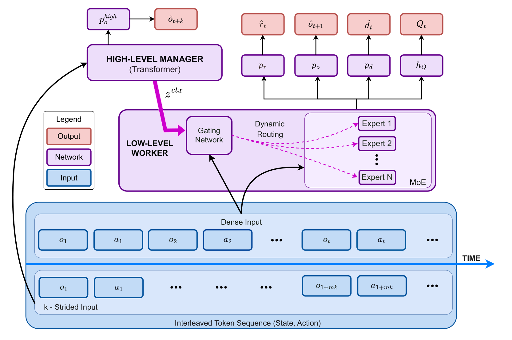
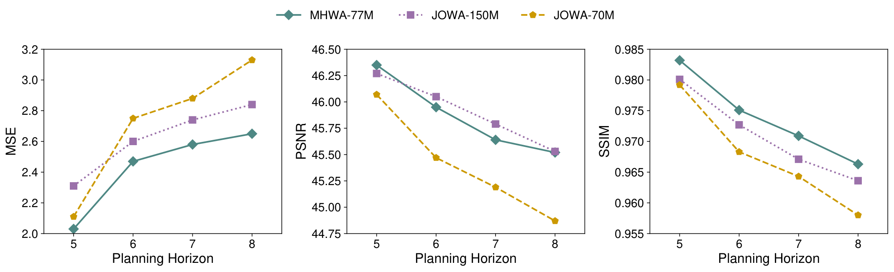
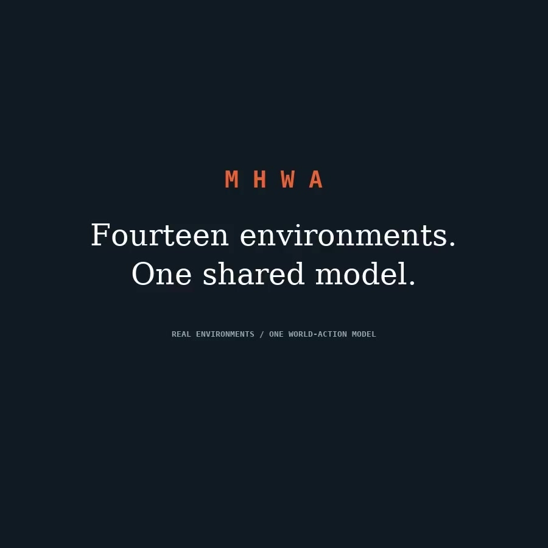

# MHWA: Multi-timescale Hierarchical World-Action Model

**Learn the world. Act with structure.**

Pengcheng Pan\*, Guoqing Ma\*, Yuhan Zhang, Yang Chen, Yichen Liu, Ziheng Li, Shan Yu†

Institute of Automation, Chinese Academy of Sciences · University of Chinese Academy of Sciences

\* Equal contribution · † Corresponding author

[**arXiv: 2610.14727**](https://arxiv.org/abs/2610.14727) · [**Project page**](https://preplic.github.io/MHWA-project-page/) · **Code release: coming soon**

MHWA combines a strided high-level context channel with a context-aware mixture
of experts for multi-game offline reinforcement learning. It explores whether
architectural structure can improve world-action modeling without relying only
on greater model scale.

This is the research preview. The public code release is in preparation.

## A hierarchy that learns context and routes computation



- **Predictive context:** a high-level Manager learns from strided trajectories
  using a skip-step observation prediction objective.
- **Separate learning signals:** stop-gradient isolates the Manager from
  low-level objectives; the Context Projector, router, and Worker remain trainable.
- **Context-aware experts:** the Worker combines context with the current token
  state, activating two of four experts per MoE layer.

## Paper results

On a 14-game Atari subset using 10% subsampled offline data, MHWA-77M reaches
**0.884 IQM HNS** using RLiable's seed-by-game aggregation across three training
seeds. It outperforms a matched JOWA-70M baseline and is numerically comparable
to the published JOWA-150M reference, with **70.88% fewer training FLOPs per sequence**.

| Model | IQM HNS | 95% stratified-bootstrap CI | Training GFLOPs / sequence |
| --- | ---: | ---: | ---: |
| JOWA-70M, matched | 0.529 | [0.459, 0.602] | 84.238 |
| **MHWA-77M** | **0.884** | **[0.736, 1.031]** | **48.199** |
| JOWA-150M, published reference | 0.833 | — | 165.524 |

MHWA and the matched JOWA-70M use the same 14-game dataset and batch setting.
FLOPs use identical input shapes: 8 frames / 296 tokens per sequence. The
published JOWA-150M result is a separate reference. Training FLOPs do not measure
inference speed. The paper also reports a mean of seed-level IQMs of
0.867 ± 0.047, which uses a different aggregation procedure.

On five held-out games, MHWA reaches **0.643 ± 0.007 IQM DNS** under the JOWA
fine-tuning protocol, compared with the published JOWA-150M result of 0.647.



## Watch the agent

[**Watch the multi-game video preview**](assets/videos/hero-showcase.mp4)

The homepage opens with an MHWA title sequence, followed by a looping four-screen
montage that cycles through the available gameplay recordings.

[](assets/videos/hero-showcase.mp4)

The project page presents full-color recordings from the 14-game Atari
suite. Each game uses one rollout with its selected buffer and planning
configuration. These recordings illustrate behavior; they are separate from
the paper's multi-seed benchmark statistics.

The collection covers Assault, Atlantis, Beam Rider, Carnival, Centipede,
Chopper Command, Demon Attack, Name This Game, Phoenix, Seaquest, Space Invaders,
Star Gunner, Time Pilot, and Zaxxon.

## Authors and affiliations

- Pengcheng Pan: affiliations 1, 2, 4
- Guoqing Ma: affiliations 1, 3, 4
- Yuhan Zhang: affiliations 1, 2, 4
- Yang Chen: affiliations 1, 4
- Yichen Liu: affiliations 1, 3, 4
- Ziheng Li: affiliations 1, 2, 4
- Shan Yu: affiliations 1, 4

1. Laboratory of Brain Atlas and Brain-inspired Intelligence, Institute of
   Automation, Chinese Academy of Sciences, Beijing, China
2. School of Artificial Intelligence, University of Chinese Academy of Sciences,
   Beijing, China
3. School of Future Technology, University of Chinese Academy of Sciences,
   Beijing, China
4. State Key Laboratory of Brain Cognition and Brain-inspired Intelligence
   Technology, Institute of Automation, Chinese Academy of Sciences, Beijing, China

Contact: [Pengcheng Pan](mailto:panpengcheng19@mails.ucas.ac.cn) ·
[Shan Yu](mailto:shan.yu@nlpr.ia.ac.cn)

## Citation

```bibtex
@misc{pan2026mhwa,
  title = {MHWA: Multi-timescale Hierarchical World-Action Model},
  author = {Pan, Pengcheng and Ma, Guoqing and Zhang, Yuhan
            and Chen, Yang and Liu, Yichen and Li, Ziheng and Yu, Shan},
  year = {2026},
  eprint = {2610.14727},
  archivePrefix = {arXiv}
}
```

## Acknowledgment

Our implementation builds on [JOWA](https://github.com/CJReinforce/JOWA).

---

To preview or publish the project page, see [deployment instructions](DEPLOY.md).
